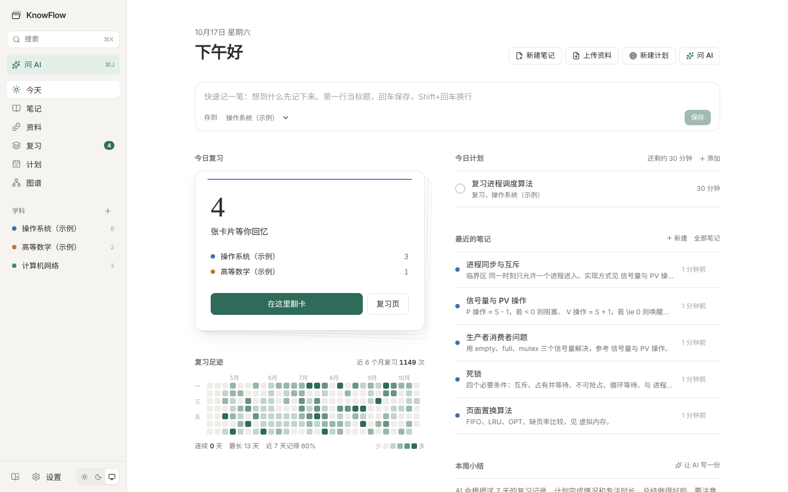
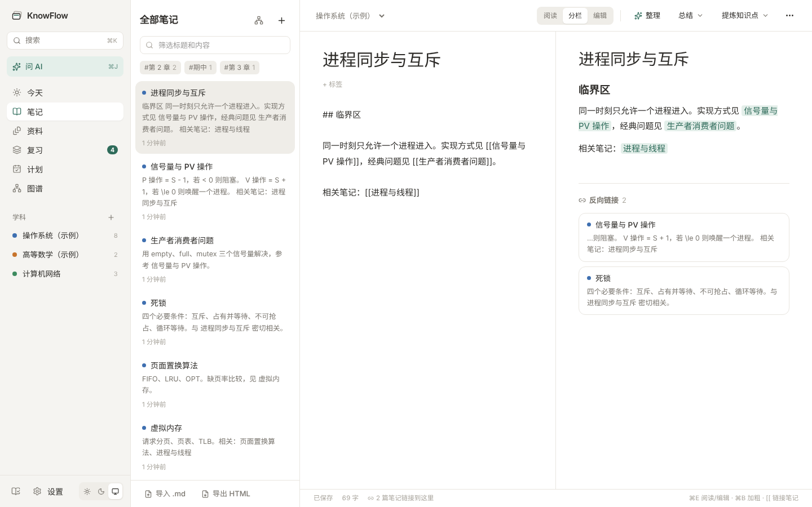
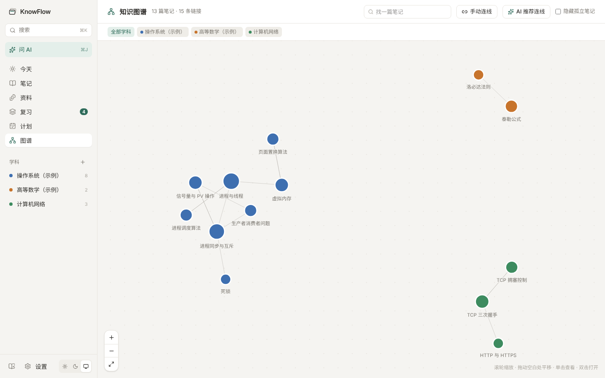
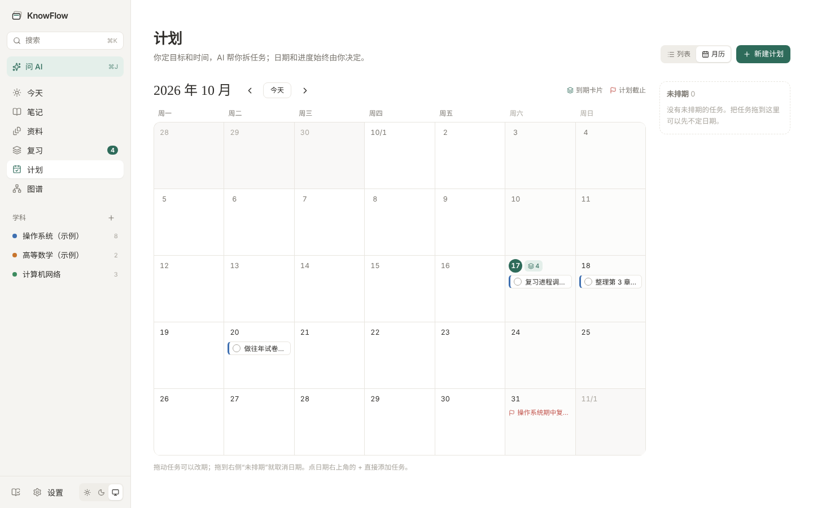
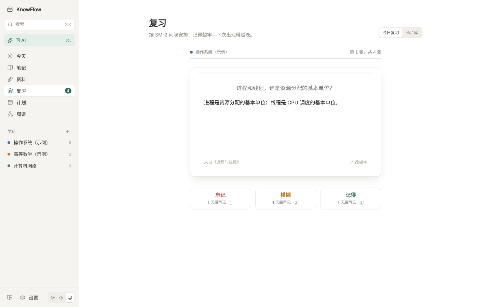
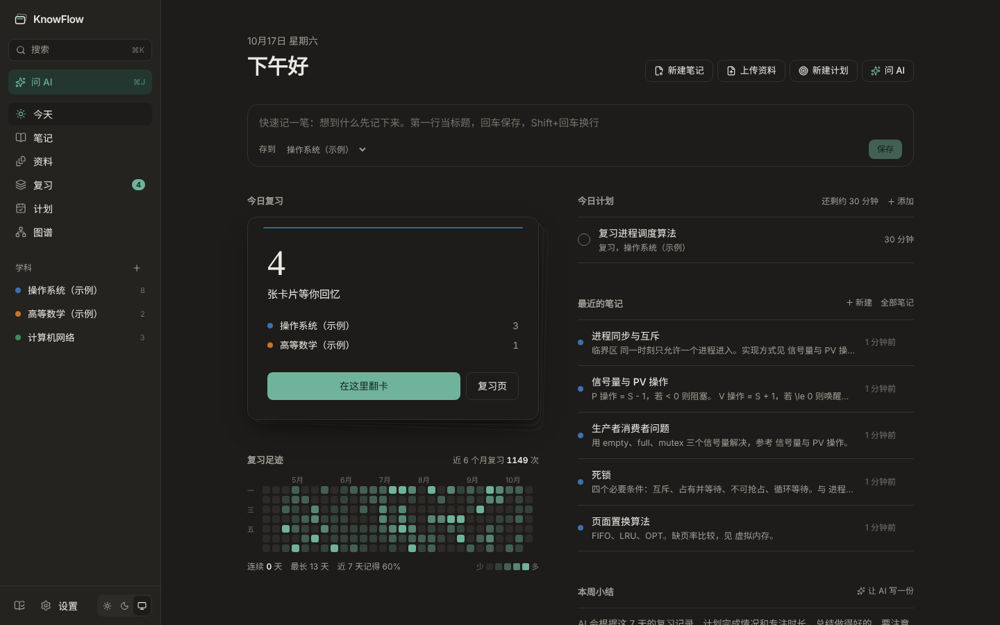

<div align="center">


# KnowFlow

**面向多学科学习的 AI 知识管理与智能复习助手**

笔记 · 资料整理 · 双链与知识图谱 · 间隔重复复习 · 学习计划 · 本机运行

[](https://github.com/jie-ot/KnowFlow/releases/latest)
[](https://github.com/jie-ot/KnowFlow/actions/workflows/desktop.yml)
[](https://github.com/jie-ot/KnowFlow/releases)
[](#-安装与启动)
[](https://github.com/jie-ot/KnowFlow/stargazers)


[安装](#-安装与启动) · [功能](#-功能) · [截图](#-截图) · [连接大模型](#-连接大模型) · [开发](#-开发) · [常见问题](#-常见问题)

</div>

---

KnowFlow 是一个在你自己电脑上运行的学习应用。你可以在里面写 Markdown 笔记，用 `[[双链]]` 把知识点连成网；把课件、讲义、板书照片交给 AI 整理成带出处的笔记；从笔记中提炼知识点卡片，按 SM-2 间隔重复算法安排复习；学习计划可以交给 AI 拆成任务，在月历上拖动安排，再配合番茄钟专注完成。

> 🔒 所有数据都保存在本机。只有你点击 AI 功能时，才会把那一次需要的内容发送给你自己配置的大模型服务商。

## 📸 截图

<table>
  <tr>
    <td width="50%"><p align="center"><b>今天</b>：快速记录、首页翻卡、复习热力图</p></td>
    <td width="50%"><p align="center"><b>笔记</b>：Markdown、公式、双链与反向链接</p></td>
  </tr>
  <tr>
    <td><p align="center"><b>知识图谱</b>：拖动连线、AI 推荐连线</p></td>
    <td><p align="center"><b>计划月历</b>：拖动改期、每日到期卡片</p></td>
  </tr>
  <tr>
    <td><p align="center"><b>复习</b>：SM-2 间隔重复，键盘 1 / 2 / 3 自评</p></td>
    <td><p align="center"><b>深色模式</b>：浅色 / 深色 / 跟随系统</p></td>
  </tr>
</table>

## ✨ 功能

| 模块 | 能做什么 |
| --- | --- |
| **今天（首页）** | 右上角一键新建笔记、上传资料、新建计划、问 AI；“快速记一笔”回车就存成笔记；在首页卡片上直接翻卡复习；今日任务可以直接添加、推到明天、开始番茄钟；最近的笔记点铅笔直接编辑；复习热力图；AI 每周小结 |
| **笔记** | Markdown 编辑，可在阅读、分栏、编辑三种视图间切换；支持 LaTeX 公式、代码高亮和表格；列表回车自动续写、Tab 缩进；按学科和标签分类；本地草稿、后台同步和冲突对比；修订历史可以撤销修改；选择多篇笔记生成带来源的复习提纲，确认后另存；删除的笔记在回收站保留 30 天 |
| **双链** | 输入 `[[` 选一篇笔记即可互相链接；点链接跳过去，目标还不存在就顺手新建；每篇笔记底部列出“谁链接到了这里”；改标题时其他笔记里的链接自动跟着改 |
| **知识图谱** | 笔记是点、双链是有向连线，支持相关、前置知识、包含和应用四种关系；可以缩放、拖动、搜索，查看某篇笔记的一层或两层邻居；“手动连线”拖到另一篇即可连上，点线修改类型或删除；“AI 推荐连线”逐条或批量确认，失败项保留重试 |
| **资料** | 上传 PDF、PPTX、DOCX、TXT、MD、代码、图片；课件截图、板书照片和扫描版 PDF 在本机自动识别文字（OCR，不联网）；按页、幻灯片、段落、表格行、行号切成片段；勾选片段后让 AI 整理成笔记，每节都标出处，点出处可以回到原文位置 |
| **AI 整理与总结** | 流式生成；左边原文、右边结果对照查看，确认后才写入笔记；自动核对数字、公式、代码有没有被改掉或漏掉；摘要分约 100 字和约 300 字两档 |
| **知识点卡片** | AI 从笔记中提炼 5–20 个知识点，你逐条修改后再加入卡组；也可以手动建卡；多次遗忘的薄弱知识点可跳到来源笔记和资料、补充理解、编辑卡片和创建关联任务；任务完成与复习掌握程度分别记录 |
| **复习** | SM-2 间隔重复，凌晨 4 点之前算前一天；空格键翻面，按 1 / 2 / 3 自评，每个按钮都显示下次复习在几天后；首页的复习热力图记录每天的复习量 |
| **学习计划** | 填写目标、当前进度、截止日、每天可用时间后，AI 拆成任务草稿；任务日期超出截止日或某天超出时间预算的，不能采纳；月历视图里拖动任务即可改期，还能看到每天要复习多少卡片 |
| **番茄钟** | 任何任务旁点计时开始专注（25 / 45 / 15 分钟可选），切换页面不中断，可以暂停、延长；时间到会提示，选“完成任务”自动打勾，每个任务记下实际花了多久 |
| **AI 每周小结** | 根据最近 7 天的复习记录、正确率、完成和逾期的任务、专注时长，写一份总结和下周建议；历史小结都会保留 |
| **AI 助手** | 侧栏“问 AI”或 ⌘J / Ctrl+J，在任何页面打开；能讲解每个功能怎么用，也会自己查你的笔记、卡片和计划来回答（只看不改）；回答里的页面和笔记可以直接点开 |
| **外观** | 侧栏底部切换浅色、深色或跟随系统 |
| **备份与恢复** | 设置 › 备份：一键导出全部数据（笔记、资料原件、卡片、复习记录、计划、小结）为一个 .zip；换电脑时选这个文件恢复。为安全起见 API Key 不放进备份；恢复前会自动把现有数据另存一份 |
| **使用说明** | 侧栏底部的书本图标打开应用内使用说明，介绍每个页面和功能；第一次打开时首页也有入口 |
| **检索与导出** | ⌘K / Ctrl+K 全局搜索笔记、资料和卡片，也能直接执行“新建笔记”“开始复习”等操作；单篇笔记导出为 .md；多篇笔记导出为一个可离线打开、可打印的 HTML，笔记间的双链在文件里也能点 |

新功能的操作、草稿恢复和数据库迁移说明见[新增功能与兼容性](docs/新增功能与兼容性.md)；实际检查及已知限制见[实施与验证记录](docs/实施与验证记录.md)。

常用快捷键（Windows 上把 ⌘ 换成 Ctrl）：

| 按键 | 作用 |
| --- | --- |
| ⌘K | 搜索，或直接执行操作 |
| ⌘J | 打开 AI 助手 |
| ⌘⇧N | 新建笔记（在笔记页） |
| ⌘E | 笔记在阅读和编辑之间切换 |
| ⌘S / ⌘B / ⌘I | 保存 / 加粗 / 斜体 |
| `[[` | 链接到另一篇笔记 |
| 空格，1 / 2 / 3 | 复习时翻面、自评 |

## 🧱 技术栈

- **前端**：Next.js 16、React 19、Tailwind CSS 4，编译成静态网页后由后端一起提供；Markdown 用 react-markdown，公式用 KaTeX，代码高亮用 highlight.js
- **后端**：FastAPI、SQLite；pypdf、python-pptx、python-docx 解析资料；latex2mathml、Pygments 用于导出 HTML
- **桌面端**：pywebview 打开独立窗口，PyInstaller 打包成 Mac 的 `.app` 和 Windows 的 `.exe`
- **大模型**：任何 OpenAI 兼容接口，例如 DeepSeek、阿里云百炼、Kimi

## 🚀 安装与启动

KnowFlow 有三种用法，用的是同一套代码和同一份数据：

| 用法 | 需要装什么 | 怎么启动 |
| --- | --- | --- |
| **桌面应用** | 什么都不用装 | 一条命令安装（见下），或下载 zip 解压后双击 |
| **网页端** | Python 3.11+ | `python run.py`，自动用浏览器打开 |
| **桌面窗口（源码运行）** | Python 3.11+ | `python run.py --app`，用独立窗口打开 |

### 桌面应用

**推荐：一条命令安装**（也用于更新到最新版）。用命令下载的文件不带“来自互联网”标记，所以不会弹系统的安全提示：

```powershell
# Windows：在 PowerShell 里运行，装到 %LOCALAPPDATA%\Programs\KnowFlow，并在桌面和开始菜单建快捷方式
irm https://raw.githubusercontent.com/jie-ot/KnowFlow/main/install.ps1 | iex
```

```bash
# macOS（Apple 芯片）：在终端里运行，装到“应用程序”文件夹
curl -fsSL https://raw.githubusercontent.com/jie-ot/KnowFlow/main/install.sh | bash
```

**手动下载**：在仓库的 **Releases** 页面下载 zip。

- **Windows**：下载后先右键 zip › 属性 › 勾选“解除锁定” › 确定，再解压，双击 `KnowFlow\KnowFlow.exe`。没解除锁定的话，SmartScreen 会提示“Windows 已保护你的电脑”（点“更多信息”›“仍要运行”）。窗口依赖系统自带的 WebView2，Windows 10/11 一般已经装好；万一窗口组件起不来，会自动改用 Edge 的应用窗口打开。
- **macOS**：解压得到 `KnowFlow.app`，拖进“应用程序”文件夹。因为没有 Apple 开发者签名，第一次打开要右键点它，选“打开”，再点“打开”；或者在终端运行 `xattr -dr com.apple.quarantine /Applications/KnowFlow.app`。目前打的是 Apple 芯片版本。

> 这些提示是因为应用没有购买代码签名证书，并不是程序有问题。要彻底去掉，需要购买 Windows 代码签名证书、加入 Apple 开发者计划并对应用签名；本项目没有做签名，用上面的一条命令安装就不会遇到。

桌面应用的数据存放在：macOS 的 `~/Library/Application Support/KnowFlow`，Windows 的 `%APPDATA%\KnowFlow`。

### 从源码运行

只需要 Python 3.11 或更新版本，不需要 Node.js。

```bash
git clone https://github.com/jie-ot/KnowFlow.git
cd KnowFlow
python run.py          # 网页端（macOS 上可能要写 python3）
python run.py --app    # 桌面窗口
```

Windows 也可以双击 `start.bat`，macOS / Linux 也可以运行 `./start.sh`，效果和 `python run.py` 一样。

第一次运行会在 `backend/.venv` 里装好依赖，大约 1–2 分钟；之后启动只要几秒。默认使用清华 pip 镜像，想用官方源：`PIP_INDEX=https://pypi.org/simple python run.py`。8000 端口被占用时会自动换一个端口。

首次启动会生成两门示例学科、几张今天到期的卡片和一个示例计划。删除示例学科，它下面的内容会一起清除。

## 🤖 连接大模型

打开 **设置 › 大模型 › 添加配置**。表单已经预填 DeepSeek 的 Base URL（`https://api.deepseek.com`）和模型名 `deepseek-flash`，填入你的 API Key，点“测试连接”即可。模型名可能随服务商更新而变化，以服务商文档为准。

- API Key 只保存在本机数据库里，页面上只显示后 4 位，不写入日志，前端也拿不到完整 Key。
- 第一次使用 AI 前会弹窗说明内容将发送给哪个服务商，同意后才发送；更换 Base URL 后需要重新确认。
- 每次请求最多 16000 字；60 秒没有响应或总时长超过 120 秒就停止。这几个数值可以在 **设置 › AI 选项** 里修改。

## 📁 项目结构

```
KnowFlow/
├── run.py                   一条命令启动（装依赖、起服务、打开浏览器或窗口）
├── start.sh / start.bat     双击或命令行启动，等同于 python run.py
├── docs/合并需求说明.md      两份需求文档如何合并、做了哪些、没做哪些
├── backend/                 FastAPI + SQLite
│   ├── app/
│   │   ├── main.py          入口：/api 接口 + 前端静态网页、本机来源校验
│   │   ├── launcher.py      启动服务并用浏览器或桌面窗口打开
│   │   ├── web/             编译好的前端（由 npm run build 生成，需要提交）
│   │   ├── routers/         接口：学科、笔记、资料、卡片与复习、计划、AI、检索导出
│   │   ├── logic/           SM-2、逻辑日、资料解析、检索、导出、计划校验、事实核对
│   │   └── llm/             大模型网关（流式、超时、错误映射）与提示词
│   ├── requirements.txt     后端依赖（锁定版本）
│   ├── requirements-desktop.txt  桌面窗口依赖（pywebview）
│   └── tests/               自动化测试
├── frontend/                Next.js 源码
├── packaging/               桌面应用打包脚本与图标
└── .github/workflows/       自动打包 Mac / Windows 桌面应用
```

后端接口文档：启动后打开 `http://127.0.0.1:8000/docs`。

## 🔧 开发

改前端时需要 Node.js 20+，前后端分开跑，前端改了会热更新：

```bash
# 终端 1：后端
cd backend
.venv/bin/uvicorn app.main:app --reload --host 127.0.0.1 --port 8000    # Windows: .venv\Scripts\uvicorn ...

# 终端 2：前端，打开 http://127.0.0.1:3000
cd frontend
npm install
npm run dev
```

**改完前端提交前，运行一次 `npm run build`**。它会把编译结果复制到 `backend/app/web/`，这样别人只装 Python 也能看到最新界面。

运行测试：

```bash
cd backend && .venv/bin/python -m pytest
```

测试覆盖：SM-2 的五张示例卡片（需求文档用例 AC-07）、凌晨 1:30 的复习算作前一天（AC-14）、整理后采纳再撤销、提炼卡片后加入卡组并复习、回收站、检索、导出的 HTML 不含脚本、接口返回中不出现完整 API Key、拒绝非本机来源的请求、资料上传与格式校验、计划超出时间预算的校验。AI 部分用模拟的大模型接口测试。

### 打包桌面应用

推荐用 GitHub Actions：在仓库的 **Actions › 打包桌面应用** 点 **Run workflow**，几分钟后同时得到 Mac 和 Windows 两个版本；推送 `v` 开头的标签（如 `git tag v0.2.0 && git push origin v0.2.0`）会自动发布到 Releases。

也可以在本机打当前系统的版本：

```bash
python run.py --app                                   # 先装好依赖并确认窗口能打开
backend/.venv/bin/pip install -r packaging/requirements-build.txt
backend/.venv/bin/python packaging/build_desktop.py   # 生成 dist/KnowFlow.app 或 dist/KnowFlow/
```

## 🔒 数据与隐私

- 数据存在 `backend/data/` 里（桌面应用在 `%APPDATA%\KnowFlow` 或 `~/Library/Application Support/KnowFlow`），包括笔记数据库和上传的资料原件。备份推荐用 设置 › 备份 › 导出备份，换电脑时在同一处选择备份文件恢复；直接复制整个数据文件夹也可以。
- 后端只监听 `127.0.0.1`，同一局域网的其他设备访问不到；不是来自本机前端的写请求会被拒绝。
- `backend/data/`、虚拟环境和打包产物都已写进 `.gitignore`，不会被提交到仓库。

## ❓ 常见问题

**第一次运行一直在“安装依赖”**
需要下载约 40 个 Python 包，网络慢时会久一点。中途按 Ctrl+C 中断也没关系，下次运行会接着装。

**Windows 上提示找不到 Python，或输入 python 打开了微软商店**
从 python.org 安装 Python，安装时勾选 “Add python.exe to PATH”；再到 设置 › 应用 › 高级应用设置 › 应用执行别名，关掉 python.exe 和 python3.exe。

**Windows 双击 KnowFlow.exe 报 “Failed to resolve Python.Runtime.Loader.Initialize”**
zip 是用浏览器下载、资源管理器解压的，文件带着“来自互联网”标记，.NET 拒绝加载。新版本会在启动时自动清除这个标记；旧版本在 PowerShell 里运行 `Get-ChildItem -Recurse "解压出来的 KnowFlow 文件夹" | Unblock-File` 后再打开，或者直接用上面的一条命令安装。

**想清理安装的依赖**
删除 `backend/.venv` 即可，源代码和 `backend/data/` 不受影响。

## 📚 文档

- [合并需求说明](docs/合并需求说明.md)：两份需求文档的冲突取舍、已实现功能、暂不实现的功能和限额来源

## 🗺️ 暂未实现

多篇笔记生成提纲。原因见合并需求说明第 3 节。
